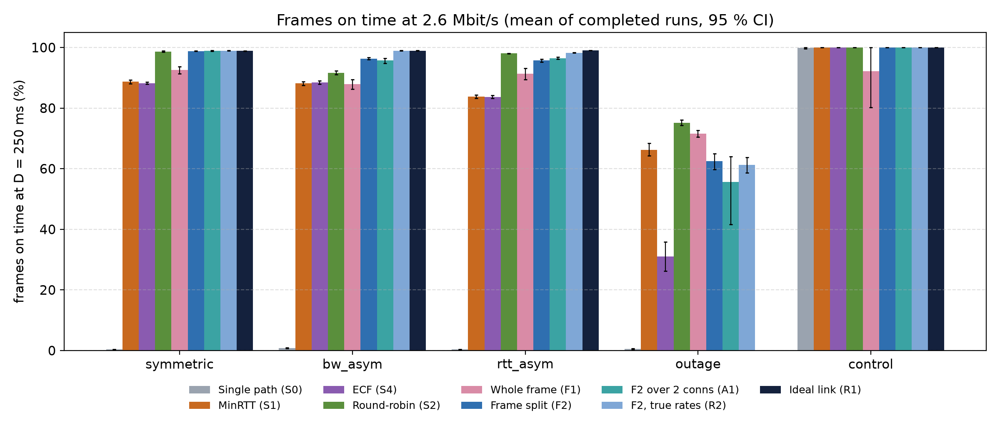

# Frame-aware multipath QUIC for live lectures (CS6048 ACN, Team 7)

**Kabir Nawal Bajaj · Prasanna Bhavan · Divyanshu** (equal contribution)

How much of two weak uplinks can an interactive live lecture use over Multipath
QUIC, and does placing whole video frames on paths (instead of single packets)
recover what packet-level schedulers waste?

| Deliverable | Where |
| --- | --- |
| Final report (problem, related work, method, results, analysis) | [`docs/Team7-final-report.pdf`](docs/Team7-final-report.pdf) · [`docs/report.md`](docs/report.md) |
| Final slides (13, incl. live demo) | [`docs/slides/Team7-final.pdf`](docs/slides/Team7-final.pdf) (source: `docs/slides/deck/`) |
| Design, hypotheses H1-H5, metrics | [`docs/proposal.md`](docs/proposal.md) |
| Lab log: what was built, what failed, evidence | [`docs/PROGRESS.md`](docs/PROGRESS.md) |
| Testbed calibration | [`docs/calibration.md`](docs/calibration.md) |
| Per-run summary (one row per run directory, run ids 1-8) and result tables | [`analysis/summary_final.csv`](analysis/summary_final.csv), [`analysis/tables/`](analysis/tables) |
| Raw per-run data (every run, calibration) | `results/` (`frames.csv`, `paths.csv`, `meta.json` per run; batch logs in `results/batches/`) |



## Main results ({RUNS} paired runs, 60 s NPTEL lecture, D = 250 ms)

- **Packet schedulers waste capacity.** At 2.6 Mbit/s over two links with 23 %
  spare capacity, MinRTT and ECF freeze the video 11-15 % of the time: they
  keep about 130 ms of video waiting in the fast link's buffer. On the 30/150 ms pair they stay smooth only up to 1.0 Mbit/s, against 2.6 Mbit/s for an ideal link of the same capacity (38 %; H2 supported).
- **Splitting frames helps.** F2 splits each frame so that both parts arrive
  together. It freezes 7-10 points less than the better of MinRTT and ECF on
  the asymmetric pairs (4.4 % vs 14.9 %, 3.8 % vs 10.8 %; 8 of 8 pairs each) and
  comes within 0.1-3.2 points of an ideal single link. Placing whole frames
  without splitting (F1) freezes 2-6 times as long.
- **Round-robin is a strong baseline.** It ties F2 on symmetric links, beats it
  on the 30/150 ms pair and under 2 s outages, and loses when the link rates
  differ. Under outages no scheduler does well; F2 is no better than MinRTT.
- **One or two connections.** At 2.6 Mbit/s the same frame logic over two
  separate QUIC connections (A1) does as well as F2. At 1.0-1.6 Mbit/s our
  single-connection F2 stalls (data for the idle fast link waits about 120 ms
  in the sender), so its usable capacity is only 0.5 Mbit/s; H4 is not
  supported as stated.
- Not tested: H1 (no phone traces were recorded) and H5 (no keyframe encoding).

What we built: a calibrated two-path netem/htb testbed (`testbed/`), a frame
streamer on TQUIC that sends each frame part as a QUIC stream (`streamer/`),
three unit-tested TQUIC hooks plus an ECF scheduler (fork `team7` branch), a
paired experiment harness (`scripts/`), and a deadline- and decode-aware
playout model with paired statistics (`analysis/`, 15 hand-computed tests).

**Code status (18 Nov):** every configuration runs from this repository with
`scripts/run.sh`. On 17 Nov three bugs in the F1/F2/A1/R2 code were fixed (the
per-path queue estimate, rescue bookkeeping, and stream ids of two connections
mixed up at the receiver), and all F1/F2/A1/R2/R1 runs were redone overnight
with the fixed code. Runs made with earlier builds are kept, unchanged, in
`results/_superseded/`.

## Team

Kabir Nawal Bajaj, Prasanna Bhavan and Divyanshu contributed equally. We worked
together on one shared laptop testbed, so the commit author names do not reflect
who did what (see report section 9).

## Live demo (about 3 minutes)

```bash
scripts/demo.sh            # live: MinRTT, then our F2, on the rtt_asym links (~65 s each)
scripts/demo.sh replay     # same, from recorded runs (no network needed)
```

The terminal shows, while the lecture streams: frames on time (250 ms
deadline), time frozen, the delay of every frame and the bytes on each link.
At the end a figure with every frame's delay for both schedulers opens
(`results/demo/<time>/demo.png`). Other scenarios or schedulers:
`scripts/demo.sh live bw_asym S1 S4`. Live runs use run ids >= 900, so they
never enter the analysis.

## Get the code

```bash
git clone --recurse-submodules https://github.com/knb2345/acn-mpquic.git
cd acn-mpquic
```

`third_party/tquic` is our TQUIC fork (https://github.com/knb2345/tquic, branch
`team7`: hooks a-c, ECF scheduler, stall fix, frame_path log, on top of
v1.6.0). If you already cloned without submodules: `git submodule update --init`.

## Requirements

Linux (we use WSL2 Ubuntu 24.04; keep the repo on the Linux filesystem, not
`/mnt/c`), with:

- Rust (cargo) and a C toolchain (for TQUIC's BoringSSL build: `cmake`,
  `clang` or `gcc`, `golang` may also be needed)
- `iproute2` with `tc`, kernel modules `sch_netem sch_tbf sch_htb`
- ffmpeg/ffprobe with libx264, iperf3
- Python 3.12 venv: `python3 -m venv analysis/.venv &&
  analysis/.venv/bin/pip install pandas matplotlib scipy`
- passwordless sudo for `ip`, `tc`, `modprobe` only (see `testbed/README.md`)

## Build and test

```bash
(cd third_party/tquic && cargo build --release --all && cargo test --release)
(cd streamer && cargo build --release && cargo test --release)
(cd analysis && .venv/bin/python -m unittest test_playout test_stats)
```

## Run

```bash
workload/download.sh stochastic             # videos are not in git (needs yt-dlp)
workload/encode.sh stochastic intra          # frame traces (.csv) are in git
testbed/up.sh rtt_asym                       # two emulated paths
scripts/run.sh rtt_asym F2 2600 intra stochastic 950   # ids 1-8 are the analysed runs
```

One run writes `results/<scenario>/<config>/<bitrate>_<encoding>_<clip>/<run_id>/`.
Batches: `scripts/batch.sh` (the final one: `scripts/overnight_20261118b.sh`).
Raw qlogs and dumps are git-ignored; per-run `frames.csv`, `paths.csv`,
`meta.json` and logs are tracked. Results are never edited by hand; runs from
earlier builds are kept unchanged in `results/_superseded/`.

## Reproduce the analysis

```bash
analysis/.venv/bin/python analysis/make_summary.py          # -> analysis/summary_final.csv
PYTHONPATH=analysis analysis/.venv/bin/python analysis/generate_report_artifacts.py
python3 docs/slides/embed_figures.py && docs/slides/deck_to_pdf.sh Team7-final.pdf
```

`generate_report_artifacts.py` prints every number used in the report and the
slides (tables also in `analysis/tables/`) and draws the figures; the report PDF
is built with `docs/build_report_pdf.py`.

## Repository layout

```
third_party/tquic/   TQUIC fork (submodule): hooks a-c, ECF, stall fix, send log
streamer/            frame sender and receiver; F1/F2/A1/R2 placement policies
testbed/             two-path emulator (netem + htb + plug), calibration
scripts/             run.sh (one run), batch.sh, demo.sh
workload/            clip download/encode scripts, frame traces (csv)
analysis/            playout model, statistics, summaries, figures
results/             raw runs; results/_superseded/ for earlier builds
docs/                proposal, report, slides, progress log, calibration
```
