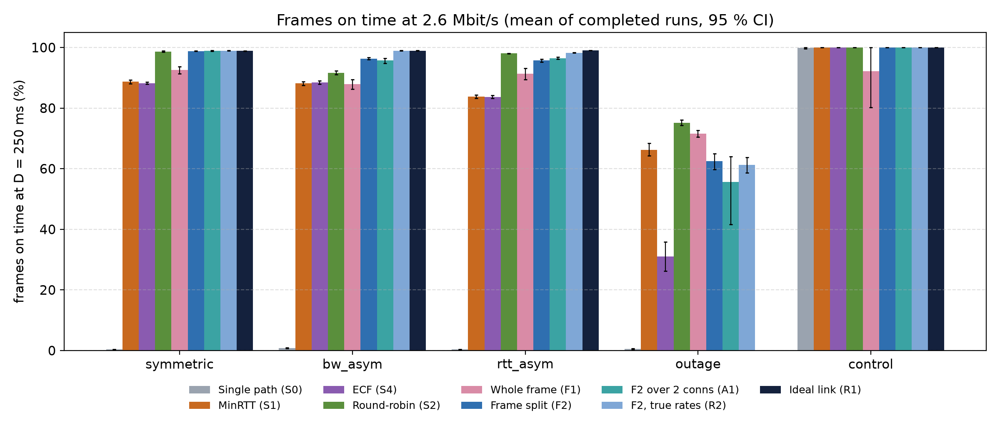
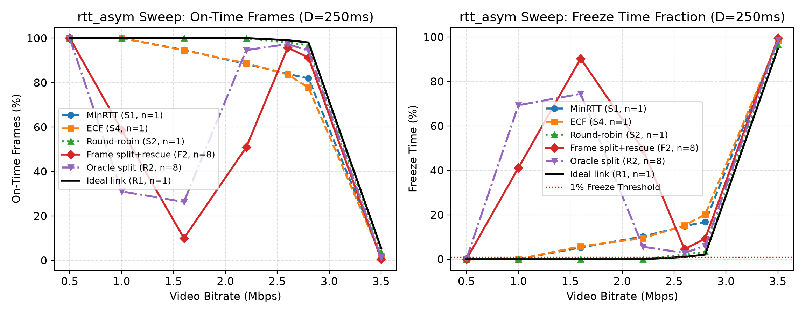
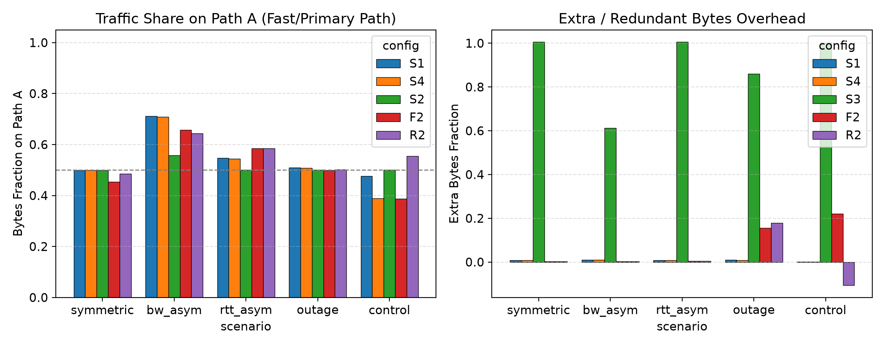

# Streaming a Live Lecture over Two Weak Uplinks: Frame-Aware Multipath QUIC

**CS6048 Advanced Computer Networks (Jul-Nov 2026) · Team 7 · Final report, 18 November 2026**

**Team:** Kabir Nawal Bajaj · Prasanna Bhavan · Divyanshu (equal contribution, see section 9)
**Code and data:** https://github.com/knb2345/acn-mpquic (TQUIC fork: https://github.com/knb2345/tquic, branch `team7`)
**Slides:** `docs/slides/Team7-final.pdf` · **Full design:** `docs/proposal.md` · **Lab log:** `docs/PROGRESS.md`

---

## Abstract

A teacher streaming a live lecture from a phone often has two weak uplinks (two
SIMs, or Wi-Fi plus mobile data), neither of which can carry a 720p camera feed
(2.6 Mbit/s) alone. Multipath QUIC can use both, but its schedulers place
*packets*, not *video frames*. We built a calibrated two-path emulation
testbed, a frame-level video streamer on TQUIC with three small transport
hooks, an ECF scheduler, frame-aware placement policies, and a deadline- and
decode-aware playout model, and measured {RUNS} paired runs (8 per setting) of
a real 60 s NPTEL lecture across five network scenarios.

At 2.6 Mbit/s, MinRTT and ECF freeze the video 11-15 % of the time even though
the two links have 23 % more capacity than the video needs; the per-path RTTs
show why: they keep about 130 ms of video queued in the fast link's buffer.
{H2_ABSTRACT} Splitting each frame across both links so that the parts finish
together (F2) cuts the frozen time by 7-10 points against the better of MinRTT
and ECF on the asymmetric pairs (4.4 % vs 14.9 % and 3.8 % vs 10.8 %, F2 lower in
8 of 8 pairs each; pre-registered P3 and P4) and comes within 0.1-3.2 points of
an ideal single link's on-time rate. Placing whole frames without splitting
freezes 2-6 times as long. Plain round-robin is a strong rival: it ties F2 on
symmetric links, beats it on the RTT-asymmetric pair and under 2 s outages,
and loses only when the link rates differ. Under outages no scheduler does
well, and F2 is no better than MinRTT. {H4_ABSTRACT}

## 1. Problem statement

- **Need.** Average uplinks in India look ample (Opensignal, Feb 2026: 5.9-8.4
  Mbit/s on private operators), yet a third or more of tests miss a consistent
  quality bar; at weak-coverage sites a single uplink regularly drops below what
  a teacher's camera feed needs (Zoom: 1.2-3.8 Mbit/s up). Bonding two uplinks
  is what industry does for live video (LiveU), but those systems are closed.
- **Why existing multipath is not enough.** Multipath QUIC schedulers were
  designed for bulk transfer, where only total throughput matters. For
  interactive video a frame is useful only if it is *complete* and *on time*,
  and with intra-refresh coding every frame depends on all earlier frames. A
  scheduler that does not know where frames begin and end can go wrong in two
  ways: it can spread a frame so that the frame waits for its last packet on
  the slower path, and it can keep one path's buffer full while the other has
  room (MinRTT prefers the low-RTT path until its window is full). Either way,
  frames queue and miss their deadline although the two paths together have
  capacity to spare.
- **Question.** How much of two weak uplinks can an interactive live lecture
  actually use over Multipath QUIC, and does placing *whole video frames* (or
  frame parts timed to finish together) on paths recover what packet-level
  schedulers waste?

Hypotheses (fixed before experiments, `docs/proposal.md` section 2):

| | Hypothesis |
| --- | --- |
| H1 | At weak-coverage sites the better single uplink is below 2.6 Mbit/s in >= 10 % of 1 s windows, and the two together at most half as often |
| H2 | At D = 250 ms, MinRTT and ECF reach < 80 % of the usable capacity of an ideal link R1 when path RTTs differ by >= 3x |
| H3 | F2 has less freeze time than the better of MinRTT and ECF on asymmetric paths, and is equivalent within 5 % on symmetric paths |
| H4 | With identical placement and rescue logic, one MPQUIC connection (F2) and two separate QUIC connections (A1) are equivalent within 5 % |
| H5 | F2's advantage is larger with 2 s keyframes than with intra-refresh |

## 2. Related work

- **Multipath transport.** MPTCP and Multipath QUIC [3, 4] let one connection
  use several paths; a *scheduler* picks the path for each packet. Common
  schedulers: MinRTT (lowest smoothed RTT with congestion-window space),
  round-robin, and redundant (every packet on every path).
- **Schedulers for paths that differ.** BLEST [5] and ECF [1] hold packets
  back from the slow path when the fast path would deliver them sooner; ECF
  compares expected completion times and is the scheduler we implemented in
  TQUIC as a baseline (S4). DEMS [6] splits a chunk so that both paths finish
  it at the same time; our F2 split applies the same idea to each video frame,
  with a finish-time estimate that counts what is already queued on each path.
- **Video over multipath.** XLINK [7] schedules video traffic over Multipath
  QUIC in a large deployment, using QoE feedback from the player; Converge [8]
  does multipath video conferencing over WebRTC with video-aware scheduling;
  the stream-aware MPQUIC scheduler [9] and Media over QUIC [10] (objects as
  streams) motivate our design of one QUIC stream per frame part. MoMQ [11]
  schedules whole frames on a relay's last hop; COMPACT [12] combines two
  devices' uplinks; LiveU bonding is the commercial, closed counterpart.
- **What this project adds.** The mechanisms are known. We measure them
  together at the sender's uplink with a deadline- and decode-aware score,
  in a paired design, against an ideal link (R1) that shows how much capacity
  is lost, an oracle (R2) that separates rate-estimation error from placement,
  and a version of the same logic over two separate connections (A1) that tests
  whether it needs Multipath QUIC at all.

## 3. Methodology

### 3.1 Testbed (`testbed/`, `docs/calibration.md`)
Two Linux network namespaces (lecturer = QUIC client, viewer = QUIC server)
joined by two veth pairs, one per path. Each veth end is shaped on egress: `tc
netem` adds RTT/2 of delay, an `htb` class limits the rate, and a bottleneck
buffer holds 200 ms of the path's rate. Time-varying scenarios (outages, trace
replay) change rates every 100 ms (`testbed/replay.py`). The emulator was
calibrated with iperf3 in 100 ms bins and loaded pings before any result
(`testbed/calibrate.sh`, `docs/calibration.md`); this caught and fixed a `tbf`
overshoot during trace replay (switched to `htb` + `plug`). `testbed/up.sh` is
idempotent, so it survives WSL restarts.

| Scenario | Path A | Path B |
| --- | --- | --- |
| control | 4.0 Mbit/s, 40 ms | 4.0 Mbit/s, 40 ms |
| symmetric | 1.6 Mbit/s, 40 ms | 1.6 Mbit/s, 40 ms |
| rtt_asym | 1.6 Mbit/s, 30 ms | 1.6 Mbit/s, 150 ms |
| bw_asym | 2.0 Mbit/s, 40 ms | 1.2 Mbit/s, 60 ms |
| outage | 1.8 Mbit/s, 40 ms | 1.8 Mbit/s, 60 ms; each path in turn at 0 for 2 s every 15 s |

### 3.2 Workload (`workload/`)
Main clip `stochastic`: 60 s of a camera-recorded blackboard lecture (Prof. V.
Balakrishnan, IIT Madras, NPTEL, CC BY-SA), 25 fps, 1500 frames. Encoded with
x264 `zerolatency`, CBR, `vbv-maxrate` = bitrate, `vbv-bufsize` = 0.5 s,
intra-refresh (no I-frame bursts). Main bitrate 2.6 Mbit/s (Zoom 720p group);
sweep 0.5-3.5 Mbit/s. Exact ffmpeg commands are stored next to each frame
trace (`workload/*.cmd.txt`); frame sizes, types and timestamps come from
ffprobe.

### 3.3 Streamer and transport (`streamer/`, `third_party/tquic`)
- Sender (lecturer, QUIC client) releases each frame at its capture time and
  sends each frame part as its own QUIC stream with a 16-byte header
  `{frame_id, offset, length, frame_size}`. The receiver completes a frame when
  the union of received byte ranges covers `[0, frame_size)`; this also makes
  rescue retransmissions and redundant copies safe. All frame streams are
  non-incremental at one urgency (strict frame order).
- Three small, unit-tested hooks in our TQUIC fork (`team7` branch):
  **(a)** stream-to-path preference, so the application can pin a stream to a
  path; **(b)** a declined-send flag, so when a scheduler chooses to *wait*
  (ECF, F1) the fallback path may send ACKs/control but not stream data;
  **(c)** the RFC 9002 section 7.8 application-limited rule for CUBIC (no window
  growth when not window-limited). We first confirmed with a test that stock
  TQUIC grows cwnd while application-limited (13.5 KB to 40 KB with under a
  quarter of the window in flight). TQUIC test suite: 564 + 1 pass; every hook
  test fails with its hook disabled.

### 3.4 Schedulers and references

| ID | What |
| --- | --- |
| S0 | Best single path (multipath off) |
| S1 | MinRTT (TQUIC built-in) |
| S2 | Round-robin (built-in) |
| S3 | Redundant (built-in) |
| S4 | ECF (our TQUIC implementation + hook b) |
| F1 | Whole frame on the path with the earliest predicted finish |
| F2 | F1 + balanced split of each frame across both paths + rescue |
| A1 | F2 logic over two separate single-path QUIC connections |
| R1 | Ideal link: one path, rate = sum of both, RTT = lower of the two |
| R2 | F2 with the true link rates instead of estimates (oracle) |

Finish-time estimate for a frame part of S bytes on path p:
`T_p = (W_p + S)/R_p + min_rtt_p/2`, where R_p is the measured delivery rate
(bytes acknowledged per interval, maximum over the last second) and W_p is
everything ahead of the part on that path: the bytes assigned to p that QUIC
has not sent yet (U_p, counted from TQUIC's per-stream send log) plus the bytes
already sent that are waiting in the path's bottleneck buffer, taken as bytes
in flight beyond one round trip at rate R_p (`inflight_p - R_p * min_rtt_p`).
The second term is the quantity that the design's `srtt_p - min_rtt_p` term
estimates; we take it from bytes in flight because srtt is smoothed and lags,
and CUBIC's window here is several times the path's bandwidth-delay product,
so bytes leave the send buffer at once and queue in the 200 ms buffer. F2
splits a frame so both parts finish together:
`S_a = ((W_b + S)/R_b + d_b - W_a/R_a - d_a) / (1/R_a + 1/R_b)` with
`d_p = min_rtt_p/2`, clamped to [0, S], and used whenever it lowers the
predicted finish; otherwise the whole frame goes to the path that finishes
first. Rescue: if a path shows no ACK progress for one PTO, its unfinished frame
parts (streams not yet fully acknowledged) are resent as new streams on the
other path.

F1, F2 and R2 run on one Multipath QUIC connection with TQUIC's round-robin
scheduler underneath, so that TQUIC offers every path in turn; each frame-part
stream is pinned to the path F1/F2 chose (hook a), so the placement is ours,
not round-robin's. A1 uses two single-path connections. R1 uses the same
shaping code with one link at the combined rate and the lower RTT.

F1, F2, A1 and R2 are sender-side placement policies in the streamer
(`streamer/src/lib.rs`: delivery-rate estimator, send tracker, finish-time
estimate, balanced split; `streamer/src/bin/mpq_sender.rs`: placement, rescue,
A1's two connections, R2's true-rate oracle), selected with `--policy`; they use
hook (a) to pin each frame-part stream to its path. The receiver keys partial
streams by (connection, stream id), so A1's two connections can reuse stream
ids. Estimator, send tracker, queue term, split and reassembly have
hand-computed unit tests (streamer: 12 tests).

### 3.5 Metrics (`analysis/playout.py`)
- **On time:** frame i is on time iff the latest completion time over i and
  every frame it depends on is <= `capture_ts + D` (intra-refresh: all earlier
  frames). Primary D = 250 ms; also 150 and 400 ms.
- **Freeze:** a gap between consecutive displayed frames >=
  max(3 x frame interval, frame interval + 150 ms) = 190 ms at 25 fps; freeze
  fraction = total freeze time / clip length.
- **Required playout delay:** smallest D with >= 99 % of frames on time.
- **Usable capacity:** highest swept bitrate with freeze <= 1 % at D = 250 ms,
  relative to R1 in the same scenario. The sweep bitrates are 0.5, 1.0, 1.6,
  2.2, 2.6, 2.8 and 3.5 Mbit/s, so a usable capacity is a bracket: the true
  value lies between the reported bitrate and the next one.
- **Bytes sent beyond the frame bytes:** stream bytes delivered on both paths
  minus the frame bytes, as a share of the frame bytes (part headers,
  retransmissions, rescue and redundant copies).

### 3.6 Experimental design and statistics (`scripts/`, `analysis/`)
One command per run (`scripts/run.sh <scenario> <config> <bitrate> <encoding>
<clip> <run_id>`); each run logs one row per frame (`frames.csv`), per-path
stats every 100 ms (`paths.csv`), CPU, and `meta.json` (git hashes of the repo
and TQUIC, binary hashes, seeds, offsets, tool versions). Batches
(`scripts/batch.sh`) build the streamer once, refuse to start with uncommitted
code, and record the build in every run.

- **Paired design.** The clip start (a multiple of 2 s) and the outage-schedule
  offset are drawn from a seed that depends only on the run id, so every
  scheduler sees the same conditions in run k. 8 paired runs per cell (run ids
  1-8; ids 0, 91 and >= 900 are development and demo runs, never analysed).
  The links themselves are deterministic, so the spread between runs comes
  from which 60 s of the lecture is streamed (its frame-size pattern) and from
  the timing of each connection, not from network randomness.
- **Builds.** S0-S4 come from the 1-2 Nov batch (streamer build 52bcb82).
  F1, F2, A1, R1, R2 and the bitrate sweep come from the 18 Nov batch (build
  da6f450, same TQUIC commit 4d7481d). The S-configurations use the same
  transport code in both builds; MinRTT and round-robin re-run with the newer
  build gave 83.1-85.7 % and 98.1 % frames on time on rtt_asym, against 83.8 %
  and 98.1 % in the 8-run means.
- **Rules (fixed before the final batch was analysed).** Runs above 80 % CPU
  are discarded and rerun (one such run, caused by laptop sleep, is logged).
  A *stalled* run, one that ended with frames still missing, is counted and
  reported but left out of means, tests and figures; a cell with 4 or more of
  8 runs stalled is reported as stalled. R1 is not shown for the outage
  scenario: its single combined link follows the outage schedule and goes fully
  dark, so it is no upper bound there.
- **Statistics.** The pre-registered primary comparisons that could be run
  (P1-P5; P6 needs the keyframe encoding, which was not run) form one family
  with Holm correction: paired Wilcoxon signed-rank tests, and paired TOST for
  the equivalence claims (margin 5 % of the reference mean, as pre-registered;
  stated in absolute terms with each result). Everything else is exploratory
  and reported as 95 % bootstrap confidence intervals. The playout model and
  the statistics have 15 hand-computed unit tests.

## 4. Results

All numbers come from `analysis/summary_final.csv` (one row per run directory
under `results/`, built by `analysis/make_summary.py`) and are printed, with the
tests, by `analysis/generate_report_artifacts.py`, which also writes the tables
in `analysis/tables/` and the figures. Raw per-run data (`frames.csv`,
`paths.csv`, `meta.json`) for every run is in `results/`. No run in the main
matrix or the sweep stalled; one run was discarded for CPU above 80 % and rerun
(logged in `results/batches/final_main_2600.log`).

### 4.1 Frames on time at 2.6 Mbit/s

Frames on time at D = 250 ms, mean of 8 paired runs (R1 is not shown for the
outage scenario, see 3.6):

{MAIN_TABLE}

- The single better path (S0) and the redundant scheduler (S3) cannot carry
  2.6 Mbit/s whenever a link is below that rate; this is expected by
  construction and serves as a sanity check (their queues grow for the whole
  run; required playout delay 21-42 s).
- With 23 % spare combined capacity, MinRTT and ECF still miss 11-16 % of frame
  deadlines on the three steady scenarios, and need a playout delay of
  453-579 ms (median over runs) to show 99 % of frames, against 229-249 ms for
  the ideal link R1.
- **Why MinRTT and ECF are late.** On rtt_asym (minimum RTTs 30 and 150 ms) the
  median smoothed RTT of the fast path is 159 ms under MinRTT and 160 ms under
  ECF, but 39 ms under round-robin (`paths.csv`, runs 1-8, after the first
  5 s). MinRTT sends on the low-RTT path until its congestion window is full,
  so about 130 ms of video waits in that path's 200 ms buffer; ECF makes the
  same choice here. Round-robin keeps both buffers short.
- ECF collapses under outages (31 % on time vs 66 % for MinRTT): while a path is
  dark its RTT estimate is stale and ECF keeps waiting for it.

### 4.2 H2: how much capacity packet schedulers waste

{H2_SECTION}

### 4.3 H3: frame-aware splitting (F2)

Pre-registered primary comparisons (freeze time at D = 250 ms, 2.6 Mbit/s, F2
vs the better of MinRTT and ECF; paired Wilcoxon, Holm over P1-P5; 95 %
bootstrap CI of the paired difference):

| | Scenario | F2 | Better of S1/S4 | Difference [95 % CI] | F2 lower | Holm p |
| --- | --- | --- | --- | --- | --- | --- |
| P3 | rtt_asym | 4.4 % | 14.9 % (S1) | -10.5 pp [-11.5, -9.5] | 8/8 | {P3} |
| P4 | bw_asym | 3.8 % | 10.8 % (S4) | -7.0 pp [-8.1, -6.0] | 8/8 | {P4} |

The symmetric part of H3, as pre-registered, says F2 is *equivalent* (within
5 %) to the better of MinRTT and ECF on symmetric links. It is not: F2 freezes
1.2 % of the time against 11.5 % for MinRTT (difference -10.2 pp [-11.4,
-9.2]); with a 5 % margin of 11.5 % (+-0.57 pp) equivalence fails because F2 is
much better.

Exploratory comparisons (freeze time, 95 % bootstrap CI, no
multiple-comparison claim):

| Scenario | Comparison | First | Second | Difference [95 % CI] |
| --- | --- | --- | --- | --- |
| symmetric | F2 vs round-robin | 1.2 % | 1.3 % | -0.1 pp [-0.3, +0.2] |
| bw_asym | F2 vs round-robin | 3.8 % | 7.4 % | -3.6 pp [-4.4, -2.6] |
| rtt_asym | F2 vs round-robin | 4.4 % | 2.1 % | +2.3 pp [+1.8, +2.8] |
| rtt_asym | F2 vs F1 (whole frames) | 4.4 % | 8.2 % | -3.8 pp [-5.7, -1.9] |
| rtt_asym | F2 vs R2 (true rates) | 4.4 % | 1.9 % | +2.5 pp [+2.0, +3.1] |
| bw_asym | F2 vs R1 (ideal link) | 3.8 % | 1.1 % | +2.7 pp [+2.3, +3.1] |
| outage | F2 vs MinRTT | 37.7 % | 34.3 % | +3.4 pp [+0.9, +5.5] |
| outage | F2 vs round-robin | 37.7 % | 25.1 % | +12.6 pp [+10.5, +14.8] |

- **Against MinRTT and ECF, F2 wins clearly** on all three steady scenarios,
  in every pair, and is within 0.1-3.2 points of the ideal link's on-time
  rate.
- **Splitting matters.** F1, which places each frame whole on the path that
  finishes it first, freezes 7.0 %, 11.2 % and 8.2 % of the time on the steady
  scenarios, 2-6 times as long as F2. Under outages F1 does better than F2
  (28.4 % vs 37.7 %).
- **Rate estimation costs about 2.5 points.** With the true link rates (R2),
  freezing drops from 4.4 % to 1.9 % on rtt_asym and from 3.8 % to 1.1 % on
  bw_asym.
- **Round-robin is a strong rival.** It ties F2 on symmetric links and does
  better on rtt_asym, where equal turns happen to suit two equal-rate paths;
  F2 is better when the rates differ (bw_asym), where round-robin overloads the
  slower link.
- **Tails.** On rtt_asym F2 has fewer late frames than MinRTT but the late ones
  are later: the playout delay needed for 99 % of frames is 752 ms (median over
  runs) for F2 against 579 ms for MinRTT and 482 ms for round-robin.
- **Outages are not solved.** With each link dark for 2 s every 15 s, F2
  freezes 37.7 % of the time, a little more than MinRTT (34.3 %) and much more
  than round-robin (25.1 %); its one-timeout rescue adds 6.4 % extra bytes but
  does not keep frames on time.

**H3 is partly supported:** F2 freezes less than the better of MinRTT and ECF
on the asymmetric pairs (P3, P4), but it is not equivalent on symmetric links
(it is better), it is not better than round-robin everywhere, and it does not
help under outages.

### 4.4 H4: one Multipath QUIC connection vs two QUIC connections

{H4_SECTION}

### 4.5 Where the bytes go

On bw_asym F2 puts 66 % of the frame bytes on the 2.0 Mbit/s path, close to
that path's 62.5 % share of the capacity, while round-robin puts 56 % there
and overloads the 1.2 Mbit/s path. Bytes beyond the frame bytes are under 1 %
for every scheduler except redundant (61-100 %) and, under outages, the rescue
of F2 and A1 (6-8 %).

## 5. Discussion

1. **The loss comes from queueing, not from a lack of capacity.** Two
   1.6 Mbit/s links carry a 2.6 Mbit/s lecture almost perfectly when the
   bytes are spread well (round-robin, F2, the ideal link), but MinRTT and ECF
   keep the fast link's buffer full and freeze the video 11-15 % of the time.
2. **Frame-awareness helps when the sender knows its queues.** Splitting each
   frame so that both parts finish together removes most of that loss. The
   finish-time estimate must count what is already waiting on each path,
   including bytes queued at the bottleneck; with only the bytes not yet
   handed to QUIC, or with a lagging srtt term, the estimate is too optimistic
   and the fast path is overloaded.
3. **The rate estimate is the remaining gap.** With the true rates, F2 would
   freeze about 2.5 points less on the asymmetric pairs.
4. **Outages need a different mechanism.** A rescue that fires after one
   timeout duplicates parts but does not keep frames on time when a link is
   dark for 2 s; round-robin, which never relies on one link, does best.
5. **Simple can be strong.** Round-robin beats MinRTT and ECF by 3-14 points
   of frames on time on the steady scenarios and rivals F2. A new scheduler
   should be compared with it, not only with MinRTT.

## 6. Threats to validity and limitations

- **Emulation only.** No real two-operator traces were collected, so H1 and
  the real_pairs scenario are untested; a public Mahimahi trace was used only
  to calibrate the emulator. The R1 mode (one link at the combined rate) uses
  the same shaping code as the calibrated two-link setup but was not
  calibrated separately.
- **Workload.** One main clip with intra-refresh encoding; the keyframe stress
  case (H5, P6) and the content controls were not run. The 8 runs per cell
  differ in which part of the clip is streamed, not in network conditions.
- **F2's queue estimate.** The design (1 Nov) estimated queueing on a path
  from srtt - min_rtt. Before the final batch we replaced that term with the
  bytes in flight beyond one round trip (section 3.4), because srtt lagged the
  bottleneck queue. The change was chosen by looking at a few development runs
  of F2 and R2 on rtt_asym at 2.6 Mbit/s (run ids 901-910, kept in
  `results/_superseded/dev_fix_20261117/`); that is the cell P3 tests, so P3
  is not fully independent of the choice. No other scenario or bitrate was
  looked at before the final batch.
- **Usable capacity is bracketed** by the sweep grid (section 3.5).
- **CUBIC only;** BBR and smaller buffers were stretch goals.

## 7. Conclusion

Packet-level Multipath QUIC schedulers use two weak uplinks poorly for live
video: MinRTT and ECF keep the fast link's buffer full, and the video freezes
11-15 % of the time even with spare capacity. {H2_CONCLUSION} Placing each frame
with a finish-time estimate and splitting it so that both parts arrive together
removes most of that loss at the 2.6 Mbit/s operating point (7-10 points less
freezing, 8 of 8 pairs), and comes close to an ideal single link. It does not
help when a link drops out, and a plain round-robin scheduler is nearly as good
on steady links. {H4_CONCLUSION}

## 8. Reproducing

See `README.md` (build, test, run). One run:
`scripts/run.sh rtt_asym S1 2600 intra stochastic 1`. Summaries:
`analysis/make_summary.py` (writes `analysis/summary_final.csv` from
`results/`); tables, tests and figures:
`PYTHONPATH=analysis python analysis/generate_report_artifacts.py`.

## 9. Team and contributions

Kabir Nawal Bajaj, Prasanna Bhavan and Divyanshu contributed **equally**. We
worked together on one shared laptop testbed throughout, so the commit author
names on GitHub do not reflect who did what. All three of us worked on the
problem definition and hypotheses, the testbed and its calibration, the TQUIC
hooks and the ECF scheduler, the frame streamer, the frame-aware schedulers and
references, the experiment batches, the playout model and statistics, and this
report and the slides.

## References

1. Y. Lim, E. Nahum, D. Towsley, R. Gibbens. ECF: An MPTCP Path Scheduler to
   Manage Heterogeneous Paths. ACM CoNEXT 2017.
2. J. Iyengar, M. Thomson. QUIC: A UDP-Based Multiplexed and Secure Transport.
   RFC 9000, 2021; J. Iyengar, I. Swett. QUIC Loss Detection and Congestion
   Control. RFC 9002, 2021.
3. Q. De Coninck, O. Bonaventure. Multipath QUIC: Design and Evaluation. ACM
   CoNEXT 2017.
4. Multipath Extension for QUIC. IETF draft-ietf-quic-multipath-21, 2026.
5. S. Ferlin, O. Alay, O. Mehani, R. Boreli. BLEST: Blocking Estimation-based
   MPTCP Scheduler for Heterogeneous Networks. IFIP Networking 2016.
6. Y. E. Guo, A. Nikravesh, Z. M. Mao, F. Qian, S. Sen. Accelerating Multipath
   Transport Through Balanced Subflow Completion (DEMS). ACM MobiCom 2017.
7. Z. Zheng et al. XLINK: QoE-Driven Multi-Path QUIC Transport in Large-scale
   Video Services. ACM SIGCOMM 2021.
8. S. D. Sathyanarayana, K. Lee, D. Grunwald, S. Ha. Converge: QoE-driven
   Multipath Video Conferencing over WebRTC. ACM SIGCOMM 2023.
9. A. Rabitsch, P. Hurtig, A. Brunstrom. A Stream-Aware Multipath QUIC
   Scheduler for Heterogeneous Paths. ACM EPIQ workshop 2018.
10. Media over QUIC Transport. IETF draft-ietf-moq-transport, 2026.
11. MoMQ. arXiv:2608.10741, 2026.
12. COMPACT. ACM MMSys 2025.
13. Tencent TQUIC, https://github.com/Tencent/tquic (v1.6.0).
14. Opensignal, India mobile network experience report, February 2026; Zoom
    bandwidth requirements (support documentation); LiveU bonding (product
    documentation).
